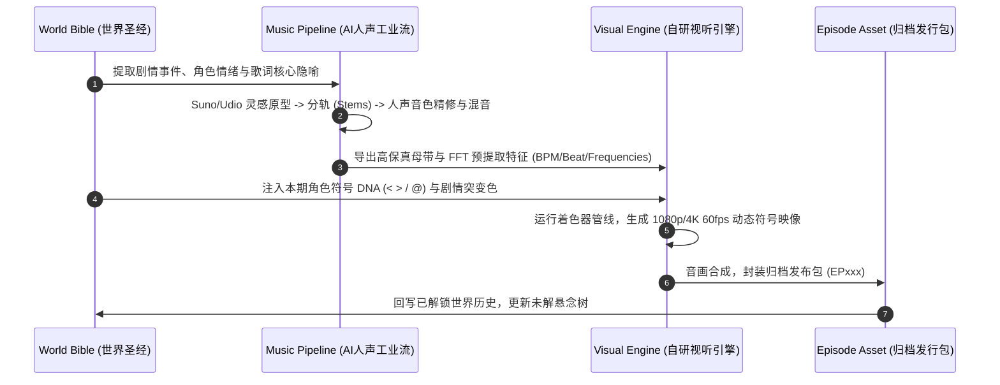

# 2. BUSINESS_LOGIC.md - 核心生产流与时序闭环

## 1. 单期作品生产时序（Production Cycle）

## 2. 跨媒介演进状态机（Transmedia Lifecycle）
- **State 1: Sandbox (0-14天)**：60秒垂直切片，验证参数联动与受众反应。
- **State 2: Serialized Music (1-12个月)**：12期连续单曲，建立铁粉认知与考据社群。
- **State 3: Interactive ARG / Visual Novel (12-24个月)**：利用 WebGL/Vue 打造终端解谜互动。
- **State 4: Standalone Game (2-3年)**：视听引擎资产直接导入 Godot/Unity，发布 Steam 独立游戏。
